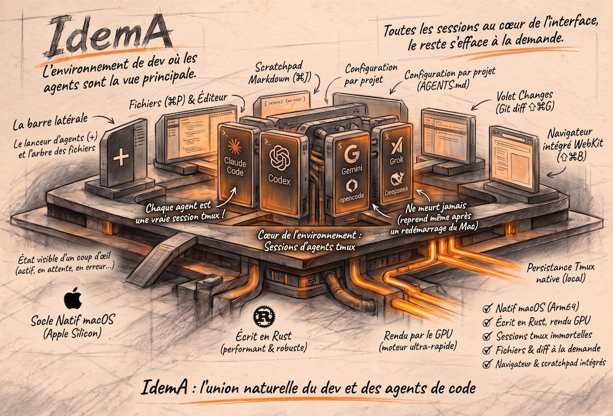

<h1>IdemA</h1>



<p align="center">
  <strong>L'environnement de dev où les agents de code sont la vue principale.</strong><br>
  Natif macOS, écrit en Rust, rendu par le GPU.
</p>

<p align="center">
  <a href="https://github.com/eRom/erom-IDEMA/releases/latest"></a>
  
  
  <a href="LICENSE"></a>
</p>

---

Les IDE mettent l'éditeur au centre et l'IA dans un panneau. IdemA fait l'inverse.

Quand on n'écrit presque plus de code soi-même, la journée ressemble à ceci : lancer des agents (Claude Code, Codex, Gemini, Grok...) dans des terminaux, les suivre, relire ce qu'ils produisent, retoucher, commiter. IdemA est construit pour ce travail-là. Chaque session d'agent est une vraie session tmux, visible dans une barre latérale avec son état. Autour, des volets sobres pour les fichiers, le diff, le navigateur et les notes, qui n'apparaissent que quand on les appelle.

## Ce que fait IdemA

**Des sessions qui ne meurent pas.** Chaque entrée de la barre latérale est une session tmux sur un serveur dédié. Que l'app se ferme ou plante, à sa réouverture la barre se reconstruit depuis tmux et tout tourne encore. Après un redémarrage du Mac, IdemA recrée sessions, panes et dispositions, et les agents Claude Code reprennent leur conversation.

**Des agents lisibles d'un coup d'œil.** Chaque session affiche son état (au repos, en cours, en attente, en erreur), déduit de signaux génériques du terminal. Un badge sur le Dock et un son signalent l'agent qui attend une réponse.

**Un terminal sérieux.** Émulation par `alacritty_terminal`, couleurs 24 bits, glyphes Nerd Font, neuf dispositions de 1 à 6 panes, zoom d'un pane, recherche dans la sortie.

**Un lanceur d'agents.** Le `+` d'un projet lance l'agent par défaut ; un clic droit ouvre la liste, rangée par moteur, avec les logos. Chaque entrée est une simple commande dans le fichier de réglages.

**Les fichiers, juste ce qu'il faut.** Arbre du projet, éditeur à onglets avec coloration, sauvegarde automatique et rechargement quand un agent réécrit le fichier, recherche et remplacement dans tout le projet. « Copier vers l'agent » colle dans le prompt de la session la référence du passage sélectionné, chemin et lignes.

**Le diff avant le commit.** Le volet Changes montre ce qui a bougé par rapport à la branche principale, worktrees compris : cases à cocher, commit, push. Aucune commande Git destructive, jamais. Un message de commit peut être proposé par un modèle (option, éteinte par défaut).

**Un navigateur intégré.** Onglets WebKit, serveurs de dev détectés (`.claude/launch.json`, à défaut le script `dev` du `package.json`, et les ports ouverts par les sessions), démarrage, arrêt et journal de chacun. Un ⌘-clic sur une URL dans un terminal l'ouvre ici.

**La configuration des agents, par projet.** Le volet Projet édite `AGENTS.md`, ajoute ou retire des skills et des serveurs MCP pour cinq harnais à la fois (Claude Code, Codex, Grok, OpenCode, Antigravity), et signale les fichiers qui ont divergé.

**Et le reste.** Un bloc-notes Markdown unique toujours à portée (⌘J). Une fenêtre Personnaliser pour les réglages d'IdemA et ceux de Claude Code (serveurs MCP, plugins, marketplaces, skills). La commande `idema <dossier>` et l'action Finder « Ouvrir dans IdemA ».

## Installation

### Prérequis

| | |
|---|---|
| Mac | Apple Silicon, macOS 26 ou plus récent |
| tmux | 3.8 ou plus récent : `brew install tmux` |
| Police | une Nerd Font, par défaut Hack Nerd Font Mono : `brew install --cask font-hack-nerd-font` |
| Agents | les CLI que vous voulez lancer : `claude`, `codex`, `gemini`, `grok`, `opencode`... |

### En une commande

```sh
curl -fsSL https://erom.cloud/install_idema.sh | bash
```

Le script télécharge le DMG de la dernière release, vérifie son empreinte et copie IdemA dans `/Applications`, puis propose d'installer [IdnmA](https://github.com/eRom/erom-IDNMA), le lanceur d'agents des menus d'IdemA. Relancé, il met IdemA à jour. Variables utiles : `IDEMA_VERSION=v0.2.1` pour une version précise, `IDEMA_APP_DIR=~/Applications` pour un autre dossier, `IDEMA_IDNMA=y` ou `n` pour répondre d'avance.

### Depuis la release

1. Téléchargez `IdemA-<version>-arm64.dmg` depuis la [dernière release](https://github.com/eRom/erom-IDEMA/releases/latest).
2. Ouvrez le DMG et glissez **IdemA** dans **Applications**.
3. Premier lancement : IdemA n'est pas notarisée par Apple, macOS la bloque donc une première fois.
   - Ouvrez IdemA, puis fermez l'alerte.
   - Allez dans **Réglages Système > Confidentialité et sécurité**, section **Sécurité**, et cliquez sur **Ouvrir quand même** (le bouton reste disponible environ une heure après la tentative).
   - Confirmez avec votre mot de passe. Les lancements suivants se font normalement.

Pour vérifier le téléchargement, posez le fichier `.sha256` de la release à côté du DMG :

```sh
shasum -a 256 -c IdemA-<version>-arm64.dmg.sha256
```

### La commande `idema`

Menu **IdemA > Installer la commande idema et l'action du Finder**. La commande est posée dans `~/.local/bin` (à mettre dans votre `PATH`) :

```sh
idema ~/dev/mon-projet   # ouvre le dossier comme projet
idema --version          # IdemA <version>
```

IdemA remet la commande à jour toute seule après une nouvelle version.

## Premiers pas

1. **⌘O** ouvre un dossier comme projet (un dossier hors Git est initialisé s'il est vide).
2. **⌘T** lance l'agent par défaut du projet ; un clic droit sur le `+` ouvre la liste des agents.
3. Les volets s'ouvrent et se ferment à la demande : **⌘P** Fichiers, **⇧⌘G** Changes, **⇧⌘B** Browser, **⌘J** Scratchpad.

Les réglages vivent dans `~/.config/idema/config.toml`, relu à chaud à chaque modification (**⌘,** ouvre la fenêtre Personnaliser). Une entrée du lanceur ressemble à ceci :

```toml
[[agents]]
name = "Claude"
harness = "Claude Code"
command = "claude"
default = true

[[agents]]
name = "Codex"
harness = "Codex"
command = "codex"
```

`harness` range l'entrée dans un sous-menu ; le logo de la session vient du nom de l'entrée (`claude`, `codex`, `gemini`, `grok`, `deepseek`, `glm`, `kimi`, `mistral`, `qwen`, `xiaomi`...) ou de `icon`. « Shell seul » est toujours disponible.

La configuration par défaut lance les agents par [IdnmA](https://github.com/eRom/erom-IDNMA) (`command = "idnma run claude"`, etc.). Sans IdnmA installé, seul « Shell seul » fonctionne : installez-le (menu IdemA, « Installer le réseau IDNMA ») ou remplacez ces commandes par les vôtres, comme ci-dessus.

## Raccourcis essentiels

| Raccourci | Action |
|---|---|
| ⌘O | Ouvrir un projet |
| ⌘T / ⌘W | Nouvelle session / fermer la session |
| Ctrl Tab / Ctrl ⇧ Tab | Session suivante / précédente |
| ⌘⌥ ← → ↑ ↓ | Passer d'un pane à l'autre |
| ⇧⌘↵ | Zoomer le pane |
| ⌘F | Chercher dans le pane |
| ⌘B | Barre latérale |
| ⌘P / ⇧⌘E | Volet Fichiers / arbre des fichiers |
| ⇧⌘F | Chercher dans le projet |
| ⌥⌘C | Copier la sélection vers l'agent |
| ⇧⌘G | Volet Changes |
| ⇧⌘B | Volet Browser |
| ⌘J | Scratchpad |
| Ctrl \` | Terminal du projet |
| ⌘, | Personnaliser |
| ⌘= / ⌘- | Taille du texte |

## Construire depuis les sources

```sh
brew install tmux librsvg
git clone https://github.com/eRom/erom-IDEMA.git
cd erom-IDEMA
cargo test --workspace          # la toolchain de rust-toolchain.toml s'installe d'elle-même
scripts/bundle-app.sh           # target/IdemA.app, signée ad hoc
scripts/make-dmg.sh             # target/IdemA-<version>-arm64.dmg
```

Le dépôt est un workspace de trois crates :

| Crate | Rôle |
|---|---|
| `idema` | l'application : fenêtre, barre latérale, volets, réglages (GPUI et `gpui-component`) |
| `idema-term` | le terminal : émulation `alacritty_terminal`, rendu, activité des sessions |
| `idema-tmux` | le client tmux en mode contrôle : serveur dédié, sessions, panes, dispositions |

La version vit à un seul endroit, `version` de `[workspace.package]` dans `Cargo.toml`. Un tag `v<version>` poussé sur GitHub construit le DMG et l'attache à une release brouillon (`.github/workflows/release.yml`).

## Compagnon iPhone

IdemA peut vous prévenir sur l'iPhone quand un agent attend, et vous laisser lui répondre. C'est éteint par défaut, sans compte Apple ni application à installer : une page web installée sur l'écran d'accueil.

1. Dans **Personnaliser › Compagnon**, activez le compagnon.
2. Exposez-le sur votre tailnet Tailscale avec `tailscale serve --bg --https=<port> localhost:<port du compagnon>` : la section affiche la commande exacte, avec votre port.
3. Sur l'iPhone, ouvrez l'adresse affichée dans Safari, puis **Partager › Sur l'écran d'accueil**.
4. Ouvrez la page installée et saisissez le code à 6 chiffres affiché dans Personnaliser (il vaut 10 minutes).
5. Activez les notifications.

Un Mac en veille, ou IdemA fermé, n'envoie aucune notification.

## Statut

IdemA est né comme l'outil quotidien d'un seul développeur et s'ouvre maintenant. Ce qu'il faut savoir :

- L'interface est en français.
- Apple Silicon uniquement, et pas de notarisation Apple pour l'instant (voir le premier lancement).
- Le lanceur par défaut suppose le réseau d'agents IdnmA de l'auteur. La section Bouillon de neurones est masquée tant que `config.toml` n'a pas de section `[ideation]`.
- La galerie Artifacts est expérimentale : elle lit vos artifacts claude.ai à travers la session du navigateur intégré, par une interface que claude.ai ne documente pas et qui peut changer sans préavis.

## Sécurité

IdemA ne collecte rien. Ce qui part sur le réseau, et quand, est détaillé dans [SECURITY.md](SECURITY.md), avec la façon de signaler une vulnérabilité.

## Licence

[MIT](LICENSE)
